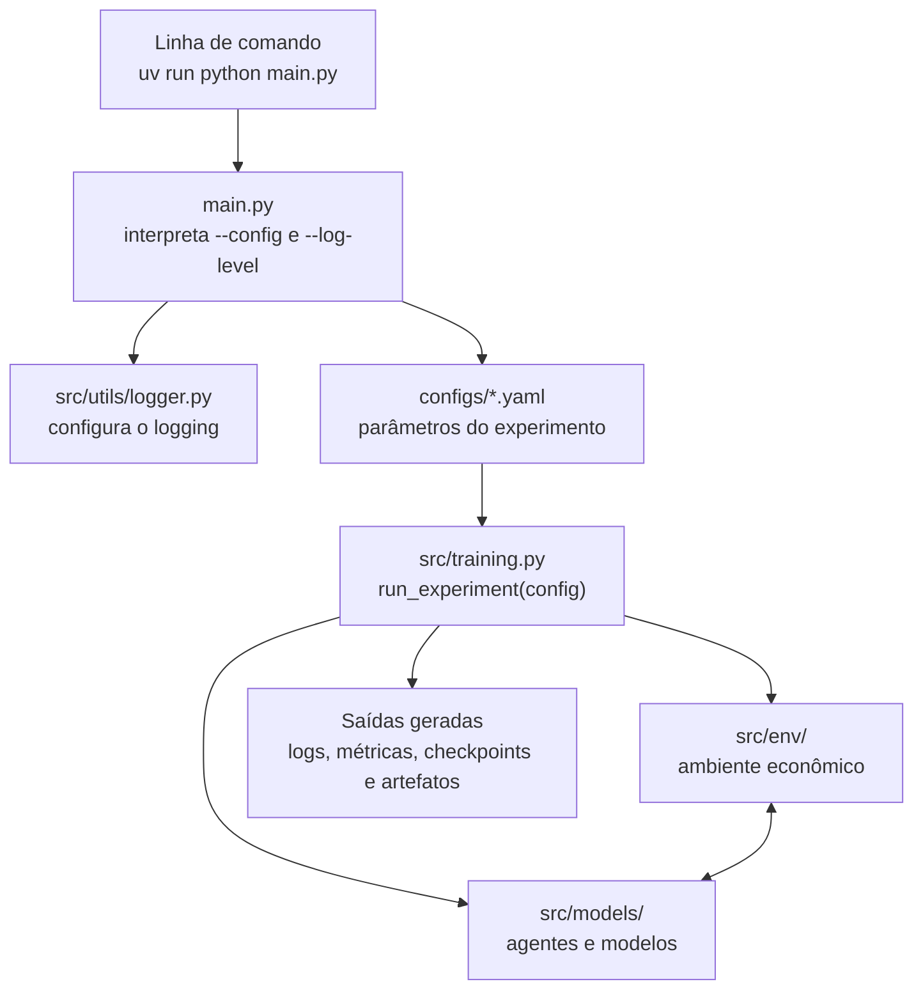

# Estrutura base do projeto

Este documento descreve como o projeto está organizado, onde ficam os principais
pontos de configuração e como uma execução percorre os seus componentes.

## Visão geral dos diretórios

```text
ai-economist/
├── configs/
│   └── default.yaml          # Configuração padrão do experimento
├── docs/
│   ├── architecture.md       # Decisões e visão técnica da arquitetura
│   └── project-structure.md  # Este guia
├── src/
│   ├── env/
│   │   └── __init__.py       # Ambientes e simulações econômicas
│   ├── models/
│   │   └── __init__.py       # Modelos, políticas e agentes
│   ├── official_examples/
│   │   ├── __init__.py
│   │   └── economic_simulation_basic/
│   │       ├── __init__.py   # Interface pública do exemplo
│   │       ├── example.py    # Fluxo executável do tutorial
│   │       ├── plotting.py   # Visualizações específicas
│   │       └── README.md     # Explicação completa do exemplo
│   ├── utils/
│   │   ├── __init__.py
│   │   └── logger.py         # Configuração centralizada de logs
│   ├── __init__.py
│   └── training.py           # Orquestração de treino e avaliação
├── tests/
│   ├── __init__.py
│   └── test_training.py      # Teste básico do fluxo de treinamento
├── .gitignore                # Arquivos locais e gerados fora do Git
├── .python-version           # Versão padrão do Python
├── main.py                   # Ponto de entrada da aplicação
├── Makefile                  # Atalhos para tarefas recorrentes
├── pyproject.toml            # Metadados, dependências e ferramentas
└── README.md                 # Instruções rápidas de uso
```

Diretórios como `artifacts/`, `checkpoints/`, `logs/` e `mlruns/` podem ser criados
durante os experimentos. Eles armazenam resultados gerados e estão ignorados pelo
Git para evitar o versionamento de arquivos grandes ou reproduzíveis.

## Responsabilidade de cada área

### `main.py`

É a porta de entrada do projeto. Atualmente ele:

1. interpreta os argumentos da linha de comando;
2. configura o nível de logging;
3. lista ou executa um exemplo oficial quando solicitado;
4. caso contrário, carrega o arquivo YAML selecionado;
5. chama `src.training.run_experiment` com a configuração carregada.

O arquivo deve permanecer pequeno. Regras de negócio, modelos e lógica de
treinamento devem ficar dentro de `src/`.

### `configs/`

Centraliza parâmetros que mudam entre experimentos sem exigir alterações no código.
O arquivo `configs/default.yaml` contém três grupos iniciais:

- `project`: nome do projeto, semente aleatória e metadados gerais;
- `environment`: parâmetros do ambiente ou da simulação;
- `training`: hiperparâmetros e controles do treinamento.

Novas configurações podem ser adicionadas lado a lado, por exemplo:

```text
configs/
├── default.yaml
├── development.yaml
└── production.yaml
```

Para selecionar uma delas:

```bash
uv run python main.py --config configs/development.yaml
```

### `src/env/`

Contém a dinâmica do ambiente econômico: estados, ações, recompensas, regras de
transição e interação entre agentes. Uma possível evolução é:

```text
src/env/
├── __init__.py
├── economy.py
├── rewards.py
└── spaces.py
```

### `src/models/`

Contém modelos de aprendizado, agentes e políticas. Cada componente relevante deve
ter uma interface clara para que o treinamento não dependa de detalhes internos.

```text
src/models/
├── __init__.py
├── agent.py
├── policy.py
└── value_model.py
```

### `src/official_examples/`

Contém versões executáveis em Python dos tutoriais oficiais. Os exemplos são
registrados em `src/official_examples/__init__.py` e podem ser descobertos ou
executados pelo ponto de entrada principal:

```bash
uv run python main.py --list-examples
uv run python main.py --example economic_simulation_basic
```

Cada exemplo ocupa um diretório próprio e segue o mesmo contrato:

```text
src/official_examples/<nome_do_exemplo>/
├── __init__.py   # Exporta a função run()
├── example.py    # Implementação executável
├── plotting.py   # Utilitários locais, quando necessários
└── README.md     # Ambiente, fluxo, decisões e referências
```

Essa organização mantém código, documentação e recursos auxiliares encapsulados.
Para adicionar um exemplo, crie o pacote, exponha `run()` em seu `__init__.py` e
adicione o caminho do módulo ao dicionário `EXAMPLES` do catálogo.

### `src/training.py`

Coordena o experimento. É o local indicado para conectar ambiente, modelos,
otimizadores, coleta de métricas, checkpoints e avaliação. Se o arquivo crescer,
essa responsabilidade pode ser dividida em módulos como `trainer.py`, `evaluation.py`
e `metrics.py`.

### `src/utils/`

Reúne infraestrutura reutilizável que não pertence diretamente ao domínio. O módulo
`logger.py`, por exemplo, define o formato e o nível dos logs para toda a aplicação.

### `tests/`

Espelha, sempre que possível, a organização de `src/`. Exemplos de expansão:

```text
tests/
├── test_training.py
├── env/
│   └── test_economy.py
└── models/
    └── test_agent.py
```

## Fluxo de entrada e execução



Em termos simplificados, o fluxo é:

```text
comando → argumentos → configuração YAML → treinamento → ambiente/modelos → resultados
```

## Pontos de configuração

| Ponto | Arquivo | Finalidade |
|---|---|---|
| Versão do Python | `.python-version` | Define a versão usada pelo ambiente local |
| Dependências | `pyproject.toml` | Declara bibliotecas de produção e desenvolvimento |
| Parâmetros do experimento | `configs/*.yaml` | Controla ambiente, treinamento e sementes |
| Argumentos de execução | `main.py` | Seleciona configuração e nível de logging |
| Logging | `src/utils/logger.py` | Define nível e formato das mensagens |
| Ferramentas de qualidade | `pyproject.toml` | Configura `pytest` e `ruff` |
| Atalhos | `Makefile` | Padroniza instalação, execução, testes e lint |
| Arquivos não versionados | `.gitignore` | Exclui caches, ambientes e resultados gerados |

## Comandos principais

Instalar o ambiente e as dependências:

```bash
uv sync --dev
```

Executar com a configuração padrão:

```bash
uv run python main.py
```

Executar com outra configuração ou logging detalhado:

```bash
uv run python main.py --config configs/default.yaml --log-level DEBUG
```

Executar testes e verificações de qualidade:

```bash
uv run pytest
uv run ruff check .
uv run ruff format .
```

Os mesmos comandos estão disponíveis como atalhos no `Makefile`: `make install`,
`make run`, `make test`, `make lint` e `make format`.

## Como adicionar um novo componente

Ao incluir uma funcionalidade, o fluxo recomendado é:

1. adicionar os parâmetros necessários em `configs/`;
2. implementar a regra do ambiente em `src/env/` ou o modelo em `src/models/`;
3. integrar o componente ao fluxo em `src/training.py`;
4. criar testes correspondentes em `tests/`;
5. registrar decisões arquiteturais relevantes em `docs/architecture.md`.

Essa separação mantém configuração, domínio, orquestração e validação independentes,
facilitando a evolução e a reprodução dos experimentos.
