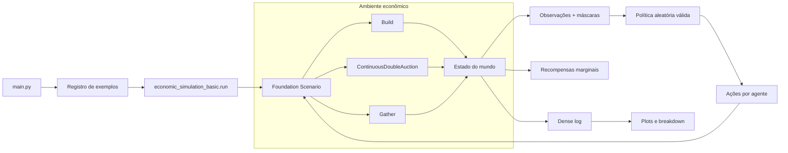
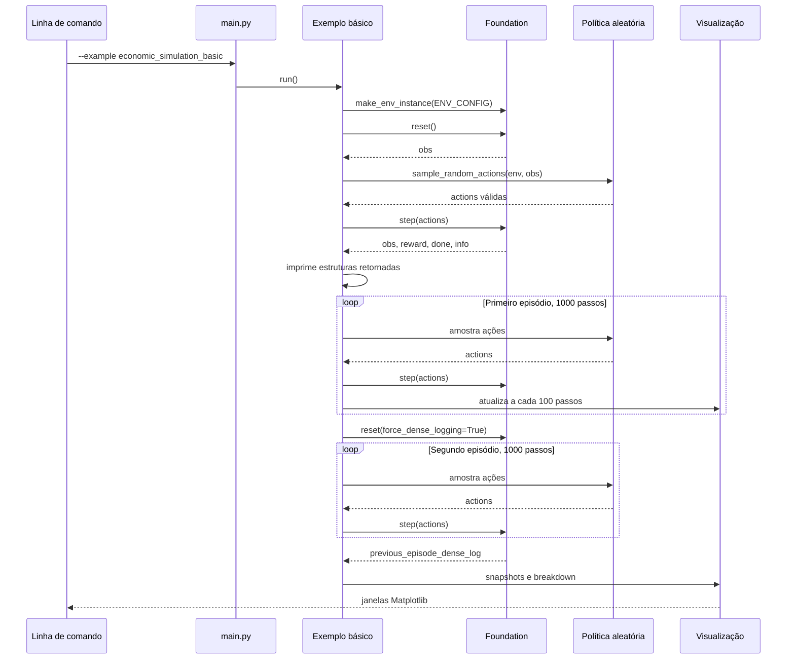
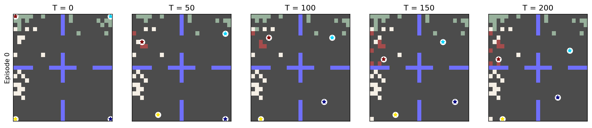
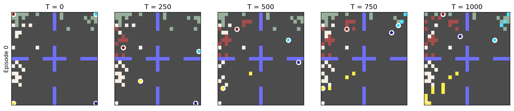
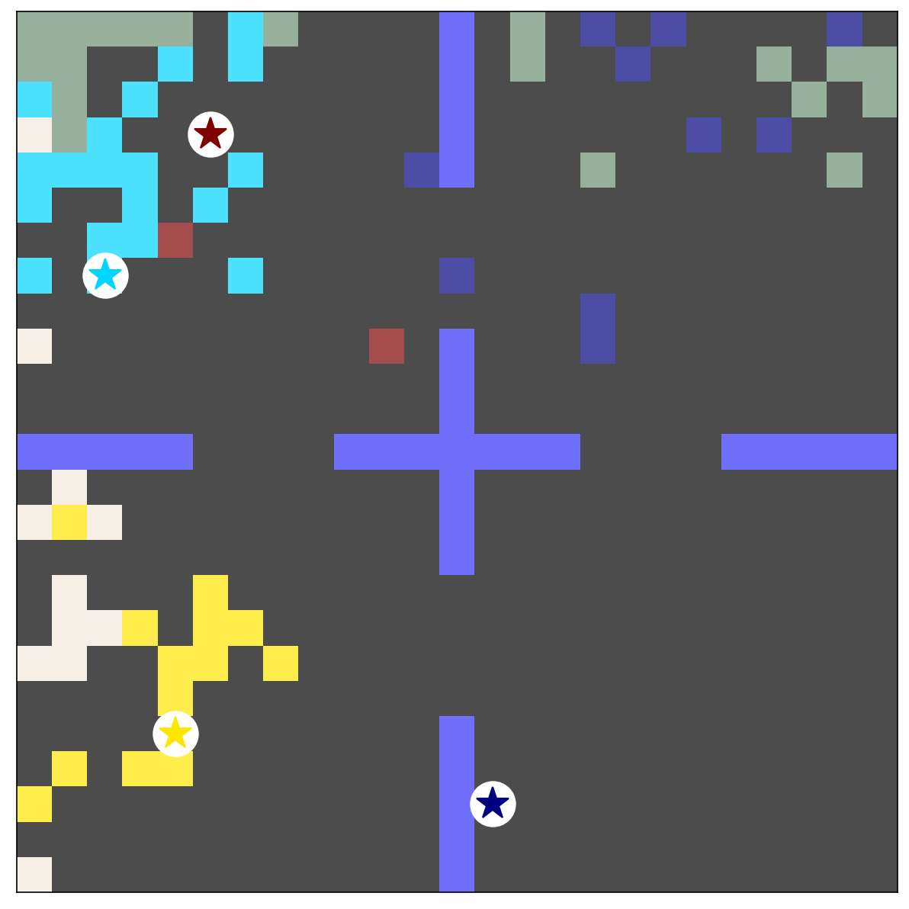
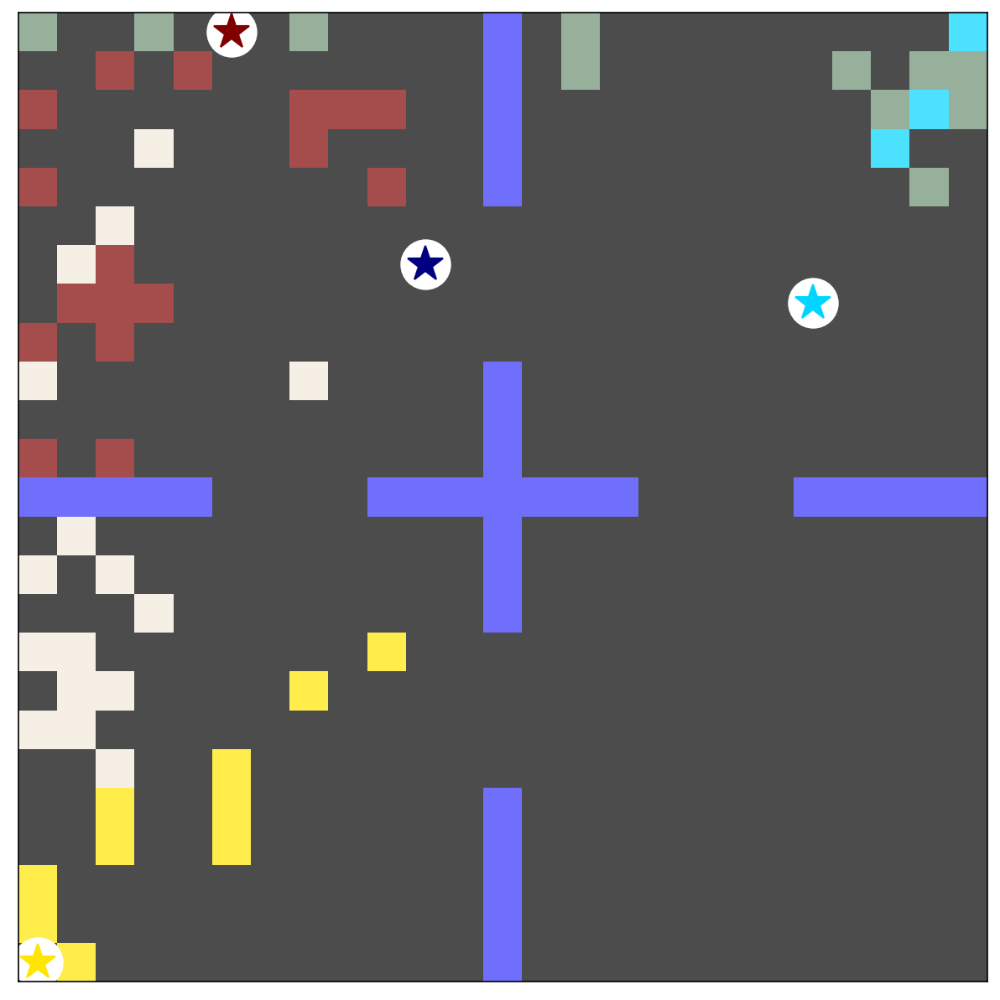
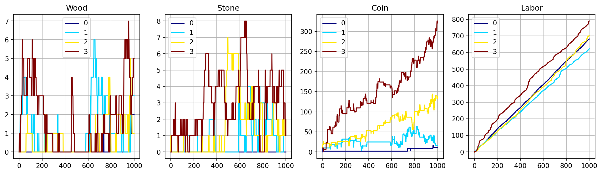
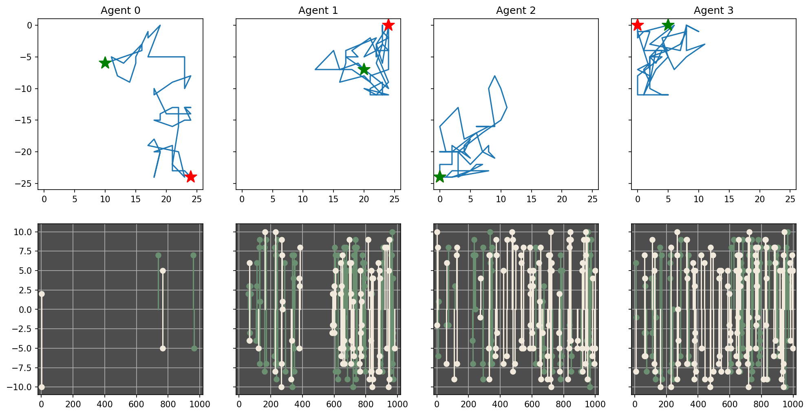

# Exemplo oficial: simulação econômica básica

Este documento explica o funcionamento de
`example.py`, uma versão Python do tutorial básico oficial do
AI Economist. O objetivo do exemplo é apresentar o simulador **Foundation**,
mostrar sua API multiagente e gerar trajetórias e visualizações de uma pequena
economia espacial.

> Importante: este exemplo **não treina um modelo**. Ele utiliza uma política
> aleatória como demonstração da interface do ambiente. O ambiente, as funções de
> recompensa e o problema de decisão são reais; o algoritmo de aprendizado ainda
> não é incluído neste tutorial básico.

## Problema abordado

O ambiente representa uma economia com quatro agentes em um mundo bidimensional.
Os agentes podem:

- deslocar-se pelo mapa;
- coletar madeira e pedra;
- comprar e vender esses recursos em um mercado;
- combinar uma unidade de madeira e uma de pedra para construir uma casa;
- receber moedas pela produção de casas;
- acumular trabalho, que reduz sua utilidade.

Cada agente enfrenta uma sequência de decisões: onde se mover, quais recursos
coletar, quando negociar, a que preço negociar e quando construir. Essas decisões
afetam tanto seu próprio patrimônio e esforço quanto as oportunidades dos demais
agentes.

O ambiente é multiagente, estocástico e parcialmente observável. A localização de
recursos, habilidades heterogêneas, ações concorrentes e ordens de mercado fazem
com que uma boa decisão dependa do estado econômico e espacial ao longo do tempo.

## Configuração usada

A configuração está em `ENV_CONFIG`, dentro de
`economic_simulation_basic.py`.

| Parâmetro | Valor | Significado |
|---|---:|---|
| `scenario_name` | `layout_from_file/simple_wood_and_stone` | Cenário econômico e mapa carregado de arquivo |
| `n_agents` | 4 | Quantidade de agentes móveis |
| `world_size` | 25 × 25 | Dimensões da grade espacial |
| `episode_length` | 1000 | Número de passos por episódio |
| `starting_agent_coin` | 10 | Moedas iniciais de cada agente |
| `fixed_four_skill_and_loc` | `True` | Usa habilidades e posições iniciais fixas para quatro agentes |
| `multi_action_mode_agents` | `False` | Cada agente escolhe uma ação global por passo |
| `multi_action_mode_planner` | `True` | O planner aceita uma ação por subespaço, caso existam componentes aplicáveis |
| `flatten_observations` | `False` | Mantém observações em campos estruturados |
| `flatten_masks` | `True` | Concatena as máscaras dos subespaços de ação |

O mapa `quadrant_25x25_20each_30clump.txt` possui quatro quadrantes separados por
água. Água é uma barreira; madeira, pedra, casas e agentes ocupam células do mapa.

## Componentes da economia

O Foundation compõe o ambiente a partir de componentes. Neste exemplo são usados
`Build`, `ContinuousDoubleAuction` e `Gather`, nessa ordem.

### Gather: movimento e coleta

O componente `Gather` oferece quatro movimentos: esquerda, direita, cima e baixo,
além do comportamento de não agir. Um movimento só é executado se a célula de
destino estiver acessível, dentro do mapa e desocupada.

Ao entrar em uma célula com recurso, o agente coleta a unidade disponível e ela é
removida temporariamente do mapa. Os recursos podem se regenerar de acordo com as
regras do cenário.

Custos padrão utilizados pelo componente:

- movimento bem-sucedido: `1.0` unidade de trabalho;
- coleta: `1.0` unidade adicional de trabalho.

Assim, mover-se para uma célula que contém recurso normalmente adiciona trabalho
pelo movimento e pela coleta.

### Build: produção de casas

O componente `Build` permite construir quando:

- o agente possui pelo menos uma madeira e uma pedra;
- a célula atual não contém recurso nem outro marco;
- a ação de construir está habilitada pela máscara.

Uma construção:

1. consome uma madeira;
2. consome uma pedra;
3. cria uma casa na posição do agente;
4. paga moedas ao agente;
5. adiciona `10.0` unidades de trabalho.

O pagamento-base é 10 moedas. Neste exemplo, `skill_dist="pareto"` e
`payment_max_skill_multiplier=3` introduzem heterogeneidade: agentes mais hábeis
podem receber pagamentos maiores pela mesma ação de construção. Essa diferença de
produtividade cria incentivos para especialização e comércio.

### ContinuousDoubleAuction: mercado de recursos

O mercado é um leilão duplo contínuo para madeira e pedra. Para cada recurso, o
agente pode:

- emitir uma oferta de compra (`bid`), informando o máximo que aceita pagar;
- emitir uma oferta de venda (`ask`), informando o mínimo que aceita receber;
- não emitir ordem.

Os preços possíveis vão de 0 a 10 moedas. O exemplo limita cada agente a cinco
ordens abertas por recurso. Criar uma ordem adiciona `0.25` unidade de trabalho.

Ao criar uma compra, o valor máximo é colocado em **escrow**. Ao criar uma venda,
uma unidade do recurso é colocada em escrow. Isso impede que moedas ou recursos
comprometidos sejam gastos duas vezes.

O mecanismo prioriza os maiores bids e os menores asks. Uma transação ocorre
quando o bid é maior ou igual ao ask. O preço usado é o da ordem que chegou
primeiro. Ordens não executadas expiram após o prazo configurado, devolvendo o
ativo em escrow ao proprietário.

## Agentes e planner

### Agentes móveis

Existem quatro `BasicMobileAgent`, identificados por `"0"`, `"1"`, `"2"` e
`"3"`. Cada um possui:

- posição no mapa;
- inventário de moedas, madeira e pedra;
- ativos temporariamente em escrow;
- trabalho acumulado;
- habilidade de construção;
- habilidade de coleta;
- estado das ordens enviadas ao mercado.

Esses são os participantes que efetivamente agem neste exemplo: movem-se, coletam,
enviam ordens ao mercado e constroem casas.

### O que é o planner

O ambiente também cria um `BasicPlanner`, identificado por `"p"`. Conceitualmente,
o planner representa uma autoridade central, como um governo ou formulador de
política econômica. Diferentemente dos agentes móveis, seu objetivo potencial não é
maximizar a utilidade de um indivíduo, mas uma medida de bem-estar da economia como
um todo.

Em cenários completos do AI Economist, componentes de política pública podem dar ao
planner decisões como definir alíquotas de impostos. Nesse caso, existe um problema
em dois níveis:

```text
planner escolhe uma política econômica
                 ↓
agentes respondem trabalhando, negociando e produzindo
                 ↓
o ambiente mede produtividade, igualdade e bem-estar social
                 ↓
planner recebe uma recompensa e pode ajustar sua política
```

### Papel do planner neste exemplo

Neste tutorial, os componentes ativos são somente `Build`,
`ContinuousDoubleAuction` e `Gather`. Nenhum deles oferece ao planner uma ação de
política pública. Em particular, não há um componente tributário, como
`PeriodicBracketTax`.

Consequentemente, o planner deste exemplo:

- não define impostos ou transferências;
- não compra, vende, coleta ou constrói;
- não controla as ações dos quatro agentes;
- não altera as regras do ambiente durante o episódio;
- não possui uma política ou modelo treinado;
- recebe observações agregadas e acompanha o estado econômico;
- recebe a recompensa social calculada pelo cenário.

Assim, ele atua apenas como **observador central e referência para métricas
sociais**. A implementação do cenário calcula, em nome do planner:

- **produtividade:** relacionada ao total de moedas da economia;
- **igualdade:** relacionada à distribuição das moedas entre os agentes;
- **bem-estar social:** combinação entre produtividade e igualdade;
- **recompensa do planner:** variação do bem-estar social entre dois passos.

O planner continua aparecendo em `obs`, `rew`, `done` e `info` porque o Foundation
mantém a mesma interface multiagente para cenários simples e completos. Isso permite
adicionar posteriormente um componente fiscal e uma política governamental sem
reformular a API do ambiente.

Em resumo, neste exemplo:

```text
agentes móveis → tomam decisões e modificam a economia
planner        → observa e recebe medidas do resultado social
```

## Estados observáveis

`env.reset()` e `env.step()` retornam um dicionário de observações com uma entrada
por agente e uma entrada para o planner:

```text
obs = {
    "0": {...},
    "1": {...},
    "2": {...},
    "3": {...},
    "p": {...},
}
```

Para um agente móvel, os principais campos são:

| Campo | Conteúdo |
|---|---|
| `world-map` | Representação espacial de recursos, marcos e agentes dentro do alcance observável |
| `world-idx_map` | Identificação espacial das entidades/agentes |
| `world-loc-row`, `world-loc-col` | Posição do próprio agente |
| `world-inventory-Coin` | Moedas disponíveis |
| `world-inventory-Wood` | Madeira disponível |
| `world-inventory-Stone` | Pedra disponível |
| `time` | Informação temporal do episódio |
| `Build-build_payment` | Pagamento que o agente recebe ao construir |
| `Build-build_skill` | Habilidade de construção |
| `Gather-bonus_gather_prob` | Probabilidade de coleta bônus |
| `ContinuousDoubleAuction-market_rate-*` | Taxa de mercado estimada por recurso |
| `ContinuousDoubleAuction-price_history-*` | Histograma decaído de preços executados |
| `ContinuousDoubleAuction-available_asks-*` | Ofertas de venda de outros agentes |
| `ContinuousDoubleAuction-available_bids-*` | Ofertas de compra de outros agentes |
| `ContinuousDoubleAuction-my_asks-*` | Ofertas de venda do próprio agente |
| `ContinuousDoubleAuction-my_bids-*` | Ofertas de compra do próprio agente |
| `action_mask` | Ações válidas no estado atual |

Por padrão, o cenário usa `full_observability=False` e alcance espacial local igual
a 5. Assim, o agente não recebe livremente todo o mapa global, embora receba
informações próprias e informações de mercado disponibilizadas pelos componentes.

### Estado, observação e dense log

Esses conceitos são diferentes:

- **estado interno**: tudo que o simulador conhece e usa para avançar a dinâmica;
- **observação**: subconjunto transformado entregue a cada agente;
- **dense log**: registro detalhado usado depois do episódio para análise e plots.

O dense log não deve ser usado como entrada de uma política durante o episódio,
pois contém informações destinadas à inspeção retrospectiva.

## Espaço de ações e máscaras

Cada componente adiciona ações ao agente:

- `Build`: construir;
- `Gather`: quatro direções de movimento;
- `ContinuousDoubleAuction`: comprar ou vender madeira/pedra em diferentes preços;
- ação 0: não agir.

Como `multi_action_mode_agents=False`, esses subespaços são combinados em um único
espaço discreto. Em cada passo, o agente escolhe apenas uma ação global, e não uma
ação simultânea para cada componente.

A máscara `action_mask` indica quais índices são válidos. Exemplos de invalidação:

- atravessar a borda do mapa ou uma célula bloqueada;
- mover-se para uma célula ocupada;
- construir sem recursos ou em uma célula indisponível;
- vender um recurso que não está no inventário;
- comprar por um preço superior às moedas disponíveis;
- exceder o limite de ordens abertas.

## Política usada no exemplo

As funções `sample_random_action` e `sample_random_actions` implementam a política:

```math
\pi(a \mid o) =
\begin{cases}
\frac{1}{|A_{válido}(o)|}, & a \in A_{válido}(o) \\
0, & \text{caso contrário}
\end{cases}
```

Na implementação, a máscara é normalizada e usada como distribuição de
probabilidade em `numpy.random.choice`. Portanto, a política:

- respeita as restrições do ambiente;
- não possui parâmetros aprendidos;
- não usa a recompensa para melhorar;
- não memoriza experiências;
- não tenta maximizar retorno deliberadamente.

Ela serve como **baseline** e teste de integração. Construções, negociações e
trajetórias resultantes são consequências aleatórias das ações válidas, não evidência
de comportamento econômico aprendido.

## Recompensas

### Recompensa dos agentes móveis

O cenário usa utilidade isoelástica de moedas menos o custo linear de trabalho:

```math
U_i(t) =
\frac{C_i(t)^{1-\eta} - 1}{1-\eta}
- \lambda L_i(t)
```

onde:

- $C_i(t)$ é o total de moedas do agente, incluindo escrow;
- $L_i(t)$ é o trabalho acumulado;
- $\eta=0{,}23$ controla a utilidade marginal decrescente das moedas;
- $\lambda=0{,}21$ é o peso do custo de trabalho na configuração padrão.

A recompensa de cada passo é a variação da utilidade:

```math
r_i(t) = U_i(t) - U_i(t-1)
```

Logo:

- receber moedas tende a produzir recompensa positiva;
- mover, coletar, negociar ou construir aumenta trabalho e gera custo;
- uma construção pode ser vantajosa se o ganho marginal das moedas compensar o
  custo do trabalho;
- a utilidade marginal da moeda diminui conforme o patrimônio aumenta.

Como a recompensa é uma diferença temporal, a soma não descontada das recompensas
telescopa para a diferença entre utilidade final e inicial. Assim, maximizar o
retorno não descontado equivale a maximizar a utilidade ao final do episódio.

### Recompensa do planner

Por padrão, o planner recebe a variação de uma função de bem-estar que combina
produtividade e igualdade:

```math
SW(t) = \text{produtividade}(t) \times \text{igualdade}(t)
```

e:

```math
r_p(t) = SW(t) - SW(t-1)
```

Produtividade está ligada ao total de moedas na economia; igualdade é derivada da
distribuição de moedas. Neste exemplo específico o planner não possui instrumento
fiscal, portanto essa recompensa é principalmente uma métrica social observada.

## Objetivo de otimização

Em um agente treinável, o objetivo usual seria maximizar o retorno esperado:

```math
J_i(\theta_i) =
\mathbb{E}_{\pi_{\theta_i}}
\left[\sum_{t=0}^{T-1}\gamma^t r_i(t)\right]
```

O agente precisaria aprender uma política parametrizada
$\pi_{\theta_i}(a\mid o)$. Entretanto, neste exemplo não existem
$\theta_i$, atualização de gradiente, função de perda ou otimizador. A ação é
amostrada uniformemente entre as opções válidas.

O tutorial demonstra a **formulação do problema**, não sua otimização.

## Modelo e arquitetura

### Arquitetura efetivamente usada neste exemplo

Não há rede neural, modelo de valor, replay buffer ou treinamento. A arquitetura é
uma composição de simulador e política procedural:



## Fluxo completo de execução



Em cada `env.step(actions)`, de forma conceitual:

1. as ações são associadas aos componentes correspondentes;
2. componentes atualizam mercado, construções, movimento e coleta;
3. o cenário atualiza estado espacial e recursos;
4. recompensas marginais são calculadas;
5. novas observações e máscaras são produzidas;
6. informações de logging são armazenadas;
7. o ambiente retorna `(obs, rew, done, info)`.

## Episódios e visualizações

O script primeiro executa um único passo para imprimir a estrutura da API. Depois:

1. executa um episódio aleatório e atualiza o mapa a cada 100 passos;
2. executa outro episódio com `force_dense_logging=True`;
3. recupera `env.previous_episode_dense_log`;
4. mostra cinco snapshots entre `t=0` e `t=200`;
5. mostra cinco snapshots distribuídos pelo episódio completo;
6. gera o breakdown econômico.

O breakdown apresenta:

- resumo de preços e quantidades negociadas;
- renda obtida por construções;
- evolução de madeira, pedra e moedas por agente;
- trabalho acumulado;
- trajetórias espaciais;
- eventos de compra e venda ao longo do tempo.

Essas visualizações ajudam a verificar se a dinâmica funciona e a diagnosticar uma
política treinada, mas não constituem métricas suficientes de desempenho por si só.

## Estocasticidade e reprodutibilidade

O exemplo usa `seed=42` por padrão. Antes de criar e executar o ambiente, o script
configura tanto `random.seed(42)` quanto `numpy.random.seed(42)`. Assim, a chamada
normal pela `main.py` reproduz a mesma sequência pseudoaleatória usada nos resultados
deste documento.

A função `run()` ainda permite informar outra seed explicitamente para estudar
outras trajetórias. Para comparações experimentais robustas, recomenda-se:

- avaliar várias seeds;
- comparar média e dispersão dos retornos;
- registrar configurações e versões;
- usar políticas de referência consistentes.

## Limitações do exemplo

- Não existe treinamento nem adaptação da política.
- A política aleatória não explora estrategicamente especialização ou comércio.
- Não há mecanismo tributário no conjunto de componentes escolhido.
- O planner não toma decisões econômicas relevantes neste cenário básico.
- Os dois episódios são demonstrações, não uma avaliação estatística.
- Os resultados não devem ser interpretados como política econômica ótima.

## Caminho sugerido para evolução

Uma sequência natural de desenvolvimento seria:

1. transformar observações estruturadas em tensores;
2. implementar uma política parametrizada para os agentes;
3. preservar as máscaras de ações durante amostragem e treinamento;
4. coletar trajetórias com recompensas e valores;
5. treinar inicialmente contra o baseline aleatório;
6. acompanhar utilidade, produtividade, igualdade, trabalho e trades;
7. adicionar um componente tributário e uma política para o planner;
8. estudar o problema em dois níveis: agentes respondendo à política econômica e
   planner adaptando a política às respostas dos agentes.

## Como executar

Na raiz do projeto:

```powershell
uv run python main.py --example economic_simulation_basic
```

Para verificar os exemplos registrados:

```powershell
uv run python main.py --list-examples
```

A execução realiza dois episódios de 1000 passos e abre várias janelas do
Matplotlib. O processo termina depois que essas janelas são fechadas.

## Execução reproduzível analisada neste documento

Os resultados abaixo foram produzidos executando os dois episódios completos com a
seed padrão `42`. As imagens estão versionadas em `assets/` e podem ser regeneradas
com:

```powershell
$env:MPLBACKEND="Agg"
uv run python -c "from pathlib import Path; from src.official_examples.economic_simulation_basic import example; example.run(show_plots=False, output_dir=Path('src/official_examples/economic_simulation_basic/assets'))"
```

O primeiro `step` confirmou a interface multiagente. O ambiente retornou observações
para quatro agentes e para o planner:

```text
dict_keys(['0', '1', '2', '3', 'p'])
```

As recompensas imediatamente após essa ação aleatória foram:

```text
0  -0.210
1  -0.263
2  -0.053
3  -0.053
p   0.000
```

Esses valores negativos não significam erro. Naquele passo, as ações adicionaram
trabalho sem produzir ganho marginal de moedas suficiente para compensá-lo. Como a
recompensa é a variação da utilidade, esforço sem renda tende a gerar recompensa
negativa. O planner permaneceu em zero porque a distribuição de moedas ainda não
teve alteração relevante.

Ao final do segundo episódio, com dense logging, o resumo foi:

| Agente | Moedas | Madeira | Pedra | Trabalho | Casas construídas |
|---:|---:|---:|---:|---:|---:|
| 0 | 11 | 2 | 0 | 681,8 | 0 |
| 1 | 17 | 3 | 1 | 622,8 | 3 |
| 2 | 133 | 1 | 2 | 702,0 | 10 |
| 3 | 326 | 5 | 1 | 790,2 | 17 |

Esses números descrevem uma realização da política aleatória, não uma política
ótima. Mesmo assim, eles deixam visível a dinâmica econômica: diferenças de
habilidade de construção, disponibilidade local de recursos e negociações aleatórias
produziram forte desigualdade de renda.

### Formação espacial da economia

#### Legenda dos mapas

| Cor ou símbolo | Significado |
|---|---|
| Fundo cinza-escuro | Célula vazia e transitável |
| Célula verde-claro | Madeira disponível para coleta |
| Célula branca ou cinza-claro | Pedra disponível para coleta |
| Célula azul-violeta | Água ou barreira; agentes não podem atravessá-la |
| Célula colorida sem estrela | Casa construída; a cor identifica seu proprietário |
| Círculo branco com estrela colorida | Posição atual de um agente |
| Estrela azul-escuro | Agente 0 |
| Estrela ciano | Agente 1 |
| Estrela amarela | Agente 2 |
| Estrela vermelho-escuro | Agente 3 |

As casas usam a mesma cor de seu proprietário. Por exemplo, células
vermelho-escuras são casas construídas pelo agente 3. Nos gráficos de trajetória,
a convenção é diferente: a estrela vermelha marca o início e a estrela verde marca
o final do percurso de cada agente.



Nos primeiros 200 passos, os agentes permanecem nos quadrantes delimitados pelas
barreiras azuis. As células claras e verdes representam pedra e madeira; as estrelas
identificam os agentes. Casas começam a aparecer principalmente no quadrante superior
esquerdo, onde está o agente 3, mostrado em vermelho-escuro. Isso já antecipa a
diferença de produção observada no fim do episódio.



Na visão do episódio completo:

- o agente 3 deixa muitas casas vermelho-escuras no quadrante superior esquerdo;
- o agente 2 constrói casas amarelas no quadrante inferior esquerdo;
- o agente 1 produz poucas casas ciano no quadrante superior direito;
- o agente 0, azul-escuro, não constrói casas no quadrante inferior direito.

A água divide o mapa e restringe deslocamentos. Embora o mercado permita transferir
recursos entre agentes sem proximidade espacial, a exploração e coleta continuam
condicionadas ao quadrante e à trajetória local.

O utilitário de breakdown gera novamente os snapshots como parte do relatório
completo:


### Estado final dos dois episódios executados

O primeiro episódio é executado sem dense logging e serve para demonstrar a evolução
visual normal:



O segundo episódio registra todos os estados e eventos necessários às análises que
seguem:



Como ambos usam uma política estocástica, seus estados finais não precisam ser
iguais. O dense log analisado no restante desta seção pertence exclusivamente ao
segundo episódio.

### Inventários, moedas e trabalho



Cada painel mostra uma dimensão do estado ao longo dos 1000 passos:

- **Wood e Stone:** inventários oscilam quando os agentes coletam, compram, vendem
  ou consomem recursos para construir. Quedas simultâneas de uma madeira e uma pedra
  podem indicar uma construção.
- **Coin:** o agente 3 termina com 326 moedas e apresenta os maiores saltos; o agente
  2 termina com 133. Os agentes 0 e 1 permanecem próximos do patrimônio inicial.
- **Labor:** cresce monotonicamente porque representa esforço acumulado. O agente 3
  chega a 790,2, coerente com mais movimento, ordens e 17 construções. O agente 1
  termina com o menor trabalho, 622,8.

O crescimento das moedas do agente 3 não é gratuito: cada casa adiciona 10 unidades
de trabalho, além dos custos de movimento, coleta e ordens. Sua habilidade de
construção faz o pagamento superar esse custo com maior frequência.

### Movimento e mercado



Na linha superior, a estrela vermelha marca o início da trajetória e a verde marca o
final. A linha é amostrada a cada 20 passos, o que evidencia a área explorada sem
desenhar todos os movimentos. Cada agente permanece no quadrante permitido pelas
barreiras.

Na linha inferior, hastes acima de zero representam receitas de venda e hastes abaixo
de zero representam custos de compra. Madeira aparece em verde e pedra em tom claro.
O agente 0 quase não participa do mercado, enquanto os agentes 1, 2 e 3 apresentam
atividade frequente durante o episódio.

O relatório textual quantifica esse comportamento:

| Agente | Compras de madeira | Vendas de madeira | Compras de pedra | Vendas de pedra |
|---:|---:|---:|---:|---:|
| 0 | 1 | 2 | 2 | 2 |
| 1 | 44 | 53 | 44 | 40 |
| 2 | 39 | 28 | 49 | 48 |
| 3 | 45 | 46 | 59 | 64 |

Os agentes mais ativos negociam dezenas de unidades. O agente 3 vendeu pedra 64
vezes e comprou 59, além de negociar madeira, indicando que o mercado é usado tanto
para obter insumos quanto para liquidar excedentes. Como a política é aleatória,
essa atividade não representa estratégia deliberada; ela emerge da amostragem de
ações válidas e das condições de inventário e escrow.

### Interpretação conjunta

Os gráficos permitem reconstruir uma narrativa coerente para essa execução:

1. barreiras espaciais limitam coleta e movimento;
2. agentes acumulam recursos localmente e os redistribuem pelo mercado;
3. habilidades heterogêneas tornam a construção mais rentável para alguns agentes;
4. o agente 3 converte recursos em 17 casas e termina com a maior quantidade de
   moedas, apesar do maior trabalho acumulado;
5. o agente 2 ocupa uma posição intermediária, com 10 casas e 133 moedas;
6. o agente 0 quase não negocia, não constrói e termina próximo do patrimônio
   inicial;
7. o resultado final é desigual, mas foi produzido por uma política aleatória e não
   por aprendizado ou otimização.

Essa última distinção é essencial: os gráficos validam o mecanismo do simulador e
mostram os incentivos do ambiente. Eles não demonstram que os agentes encontraram
uma solução ótima.

## Arquivos relacionados

- `example.py`: fluxo executável do tutorial;
- `plotting.py`: visualizações e relatórios;
- `__init__.py`: registro de exemplos disponíveis;
- `../../../main.py`: entrada e seleção via `--example`;
- `../../../pyproject.toml`: dependência e versão do AI Economist.

## Referências

- Notebook original: <https://github.com/salesforce/ai-economist/blob/master/tutorials/economic_simulation_basic.ipynb>
- Repositório oficial: <https://github.com/salesforce/ai-economist>
- Artigo AI Economist: <https://arxiv.org/abs/2004.13332>
